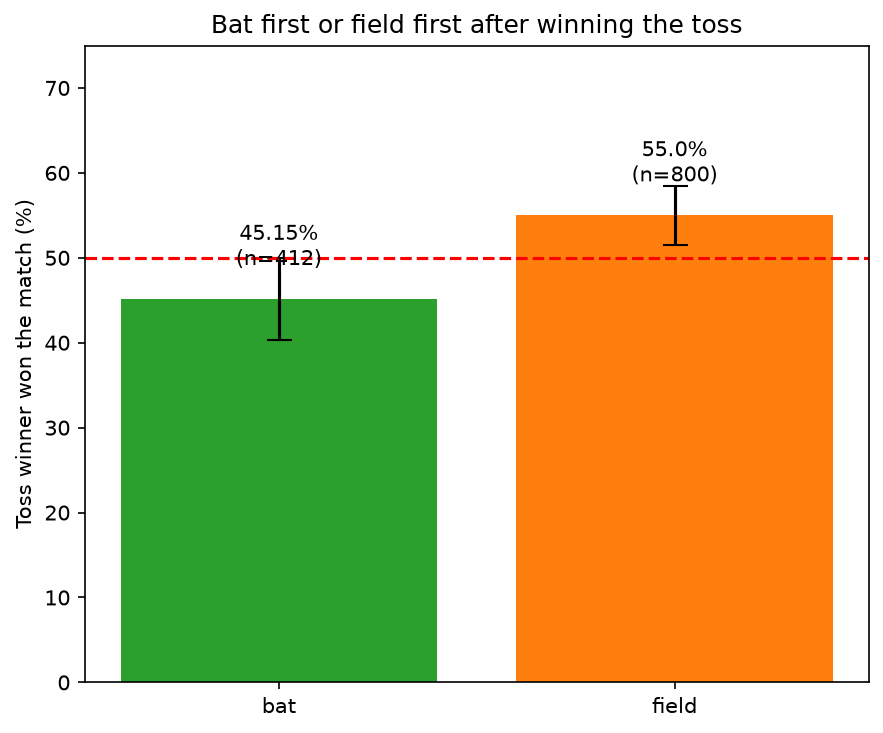
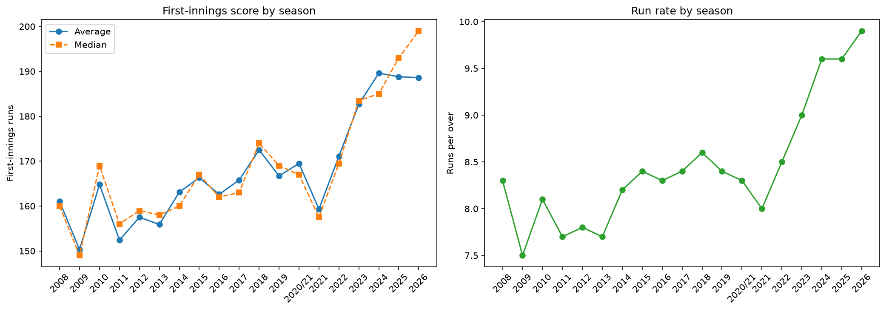
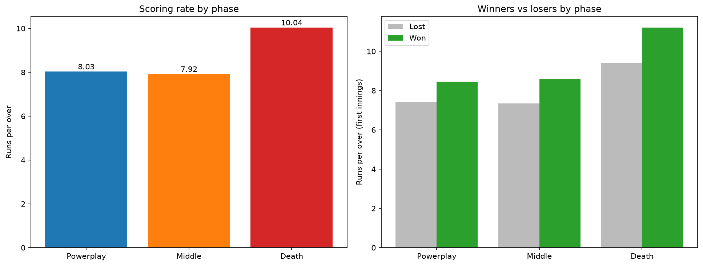
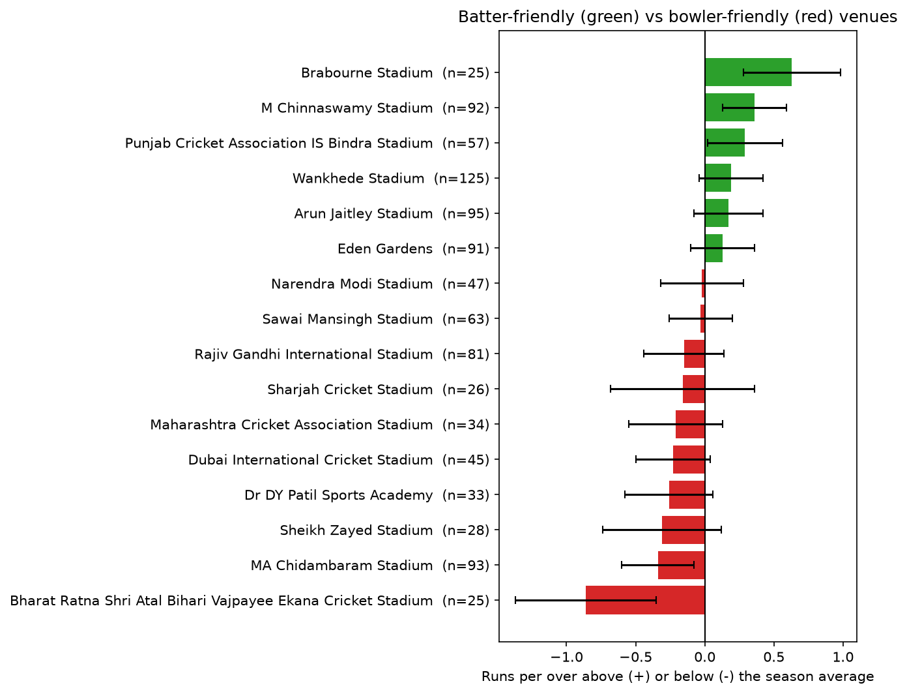
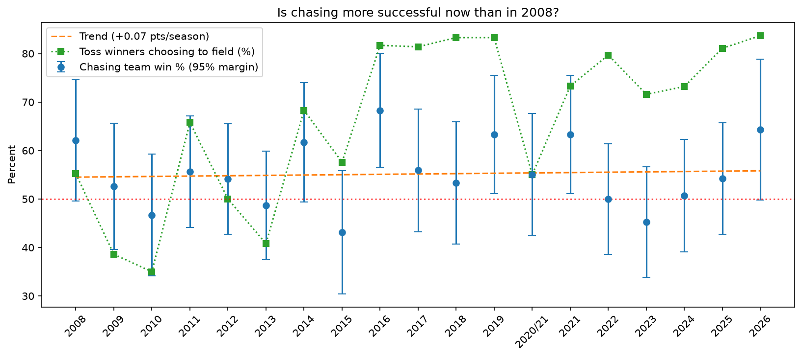

# IPL EDA: What Decides an IPL Match?

Exploratory data analysis of every IPL match from 2008 to 2026. I asked six clear questions about the toss, scoring, match phases, venues, chasing and players, and answered them with numbers and charts.

**Author:** Jagjeet Sonwalkar

**Full report:** [outputs/IPL_EDA_Report.docx](outputs/IPL_EDA_Report.docx)

## Main Findings

| Question | Answer |
|---|---|
| Does winning the toss help? | Not by itself: toss winners won 51.7% of 1,212 matches (95% range 48.8% to 54.5%). But toss winners who chose to **field** won 55.0%, and those who chose to **bat** won 45.1%. |
| How has scoring changed? | Average first-innings score went from 161 (2008) to 189 (2026). Sixes per match went from 10.7 to 18.4. Most of the rise came from 2023 onward. |
| Which phase decides matches? | The death overs separate winners from losers the most (winners score 11.2 runs per over, losers 9.4). The middle overs matter almost as much. |
| Which venues help batters or bowlers? | Only 5 of 16 venues differ clearly from the season average. M Chinnaswamy and Mohali help batters. Chennai and Lucknow help bowlers. |
| Is chasing more successful now? | Chasing teams win about 55% of matches, and this has not changed over time (54.6% in 2008 to 2016, 54.8% in 2017 to 2026). |
| Best players | Most runs: V Kohli (9,040). Most wickets: YS Chahal (228). |

## Charts







## Data

- **Source:** https://www.kaggle.com/datasets/maratheabhishek/ipl-dataset-2008-to-2025
- **Files used (5):** ball_by_ball_data.csv, ipl_matches_data.csv, players-data-updated.csv, team_aliases.csv, teams_data.csv
- **Size:** 1,212 matches and 288,226 balls
- The data files are **not included** in this repo. Download them from the Kaggle link.
- 2026 has only 43 matches in the data, so it is a partial season.

## Project Structure

```
IPL - EDA/
    data/
        (5 raw csv files)
        cleaned_data/
    images/
    outputs/
        IPL_EDA_Report.docx
    src/
        cleaning_the_data.ipynb
        ipl_story.ipynb
```

## How to Run

1. Download the dataset from the Kaggle link and put the 5 csv files in the `data` folder.
2. Install the libraries: `pip install -r requirements.txt`
3. Open the `src` folder and run `cleaning_the_data.ipynb` from top to bottom. It saves the cleaned files in `data/cleaned_data/`.
4. Run `ipl_story.ipynb` from top to bottom. It reads the cleaned files and saves the charts in `images/`.

## What I Did

- **Cleaning:** gave every team one latest name, filled missing values with meaning (for example "none" when there was no wicket), checked for duplicates, dropped columns that were not needed, and made new columns (phase, chase result, toss result and more).
- **Analysis rules:** super overs were left out of scoring numbers. Venues need at least 20 matches. Players need at least 500 balls. Small samples show a 95% margin of error.

## Limits

- Each season has only about 60 to 75 matches, so one season's numbers can be noisy.
- Venue results also include pitch, weather, dew and home-team effects.
- The results show patterns, not proof of cause.

## Tools

Python, pandas, numpy, matplotlib, seaborn, Jupyter Notebook.
